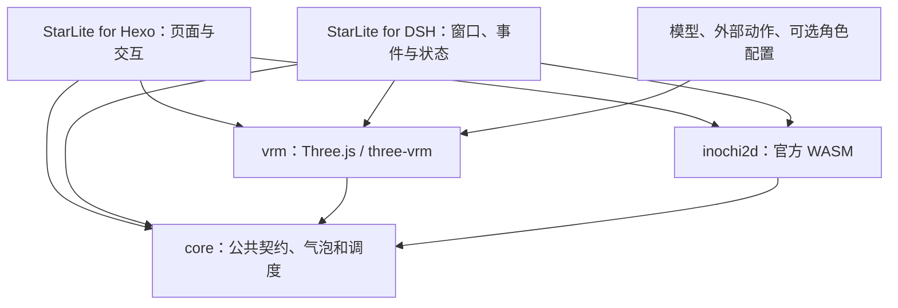

# StarLite 架构与命名

代码分为运行时与桌宠两个仓库；角色资源独立分发。既不按博客／桌宠复制一套渲染器，也不把 DSH 状态协议放进渲染器。

```text
starlite/
  packages/
    core/           @starcried/starlite-core
    vrm/            @starcried/starlite-vrm
    hexo/           hexo-starlite
    inochi2d/       @starcried/starlite-inochi2d
    inochi2d-blog/  可选、格式专用原生辅助 CLI
  crates/inochi2d-pipeline/
  examples/
  docs/
  tools/

starlite-dsh/
  apps/desktop/          StarLite for DSH
  packages/dsh-plugin/   dsh-starlite / StarLite DSH Bridge
  packages/protocol/     私有共享协议

Weiguang for StarLite    单独授权的角色资源包
```

本机两个源码目录已统一为 starlite 与 starlite-dsh。桌宠已有 identifier、deep link、原生可执行文件名和用户数据路径用于保持现有安装与设置；远端迁移状态见 [当前状态](status.md)。

## 依赖方向



`core` 不导入任何后端，公共动作目录只包含名称和时长。两种后端提供 `mountModelWidget` 与播放、停止、暂停、恢复、镜头复位、销毁契约；取消中的挂载以及迟到实例由公共生命周期处理。Inochi2D 参数接口不模拟成 VRM 骨骼接口。

`vrm` 负责容器检查、带哈希资源包准备、VRMA 播放、材质、骨骼、视线、表达及物理。微光专属耳姿、眨眼和配饰只由其角色配置启用。通用模型不要求微光配置，也不能自动获得其自定义行为。

`hexo` 读取唯一配置入口 `starlite:`，按后端收集资源并生成哈希路由。移动端在动态导入之前退出；页面空闲启动；PJAX 保留一个实例；完整页面导航会建立新实例，但同一标签页不会重复首次入场。浏览器只加载选中的后端。目前 npm 安装依赖仍包含两个后端；移除 VRM 默认路径对 Inochi2D 的安装依赖属于下一阶段。

DSH 的桥接插件在 DSH 宿主内运行，处理会话事件和受保护的本机连接；Windows 桌宠负责窗口、气泡、状态映射及渲染。核心渲染器不查询 API 余额，也不感知 DSH 会话协议。

## 模型准备与许可

VRM 使用 `@starcried/starlite-vrm/prepare` 检查模型、动作和可选 profile，写入新目录并生成逐项哈希清单。工具不制作动画、不自动减面，也不覆盖源工程。Hexo 再验证清单和发布确认；素材授权仍由操作者核实。

Inochi2D 保留 `inochi2d-pipeline` 和 `inochi2d-blog`，以及 `.inochi2d` 缓存路径。它们只处理该格式，不能准备 VRM。官方 SDK、构建 pin 与原生许可检查详见 [upstream](upstream.md)、[pipeline](pipeline.md)。

## 尚待完成的产品边界

当前无动作 VRM 可以预览原始姿态；自然通用姿态／原创默认 Idle、轻呼吸、DSH 无动作导入和气泡脱离动作的配置仍需实现。已经确认的下一阶段目标见 [status](status.md)。本轮更名不改变播放、渲染、物理或性能策略。
